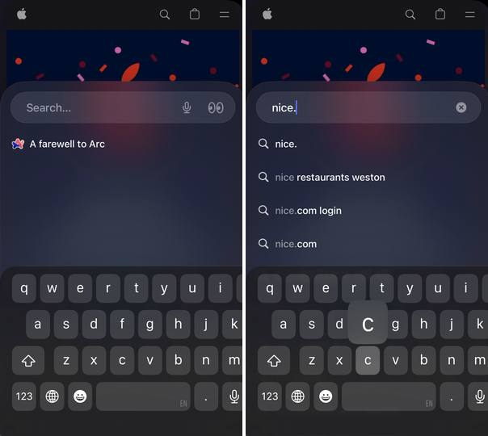
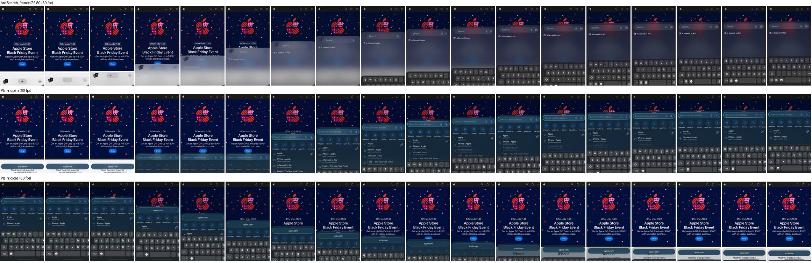

# Arc Search's address bar expand, and the sheet Plain builds from it (2026-11-27)

The owner, on TestFlight: "I don't like the way the address bar expands out. Really look at what
Arc does. It's not even clear how I dismiss the one you implemented. I like how the bar/text field
ends up at the top, and I like how the transition grows into the expanded thing. And also the
options on the text field and the sizing of the text field." And: "The field should sit at the
bottom as it is now, but when expanded the text field should go to the top."

This note records Arc Search's expand frame by frame, the sheet Plain builds from it, and the
decisions Arc gives no reference for (the way out). Plain takes the motion, the layout and the
sizes; the surface, colors and words are Plain's own (paper, Liquid Glass on the field only).

Tags: **[M]** measured from the recording, **[I]** inferred, **[P]** Plain's own decision.

## 1. Arc Search, frame by frame

Source: the owner's screen recording of Arc Search on the iPhone Duo's outer screen (1398×2034
px, 466×678 pt, 3 px = 1 pt; the app area is 382 pt wide beside the system's bar), read at 60
frames a second. The tap lands at frame 72 (1.200 s). Frame *n* is *n*/60 s.

*Frames 72–83, left to right, top to bottom: the bar turns to dark material in four frames, its
top edge rises, the "+" capsule widens into the field, the bar's icons ride up and fade, and the
first row is there before the sheet is half way.*

**The move [M]**

| Frame | ms after tap | Sheet top (pt from the top) | Travelled |
|---|---|---|---|
| 73 | 17 | 557 | 0% |
| 75 | 50 | 495 | 14% |
| 76 | 67 | 421 | 32% |
| 77 | 83 | 355 | 47% |
| 78 | 100 | 299 | 60% |
| 80 | 133 | 217 | 79% |
| 82 | 167 | 175 | 89% |
| 84 | 200 | 151 | 94% |
| 87 | 250 | 134 | 98% |
| 91 | 317 | 127 | 100% (rest) |

- It starts from rest and accelerates, never overshoots, is 90% of the way in about 170 ms and at
  rest by about 300 ms: a critically damped spring of about 0.25–0.28 s. Travel 430 pt.
- The whole bottom bar becomes the sheet: there is no second surface arriving from elsewhere.
- The bar's background goes from opaque light to frosted dark material in about 4 frames (67 ms).
- The "+" capsule widens into the field, riding 16 pt under the sheet's top; the caret is in it
  one frame after the tap. "+" fades as the placeholder appears.
- The bar's icons (tabs, chevron) ride up with the sheet and are gone by frame 79 (about 100 ms).
- The first row ("A farewell to Arc") fades in under the field from frame 74 and is full by about
  frame 77; it rides with the field.
- The microphone appears in the field about frame 79, the second icon about frames 82–84.
- The keyboard starts about frame 79 (100 ms after the tap) and is up by about frame 92.

**At rest [M]**

- Sheet top at 127 pt: 18.7% of the screen. Top corners about 33 pt, continuous. The sheet runs to
  the bottom edge behind the keyboard. Its color is about `#2c3144` with the page's colors blurred
  through.
- The page above the sheet stays sharp and is dimmed about a fifth (`#000f36` → `#000d2b`).
- Field: 348×48 pt, a capsule, 16 pt from the sheet's sides and 16 pt under its top; a fill about
  10% lighter than the sheet with a hairline. Placeholder "Search…", 17 pt, secondary grey, 24 pt
  from the field's edge.
- In the field, trailing: a microphone (center about 43 pt from the field's edge beside the next
  icon) and a "googly eyes" glyph 18 pt from the edge. Once something is typed, both are replaced
  by one clear (×) button. The eyes are Arc's own glyph; most likely its Browse for Me switch **[I]**.
- Rows: 52 pt each, top down, right under the field (first row's center about 33 pt under the
  field); icon at 18 pt, text at 47 pt, 17 pt text; no section headers.
- No grabber, no Cancel, no close button. **The recording has no dismissal** (the owner goes to
  the app switcher), so Arc gives no reference for the way out.

## 2. What Plain builds

Plain's resting chrome is not Arc's bar: a floating glass pill (48 pt, the row's width) over a
glass button bar, nothing behind them. The pill is already the size of Arc's field, so on a page
the field does not change size at all: the morph is a pure move.

| | Arc Search | Plain |
|---|---|---|
| Sheet top | 18.7% of the height | the same (`SearchSheetGeometry.topShare`), never closer than 8 pt to the safe area; right under the safe area on a screen under 560 pt tall (a phone on its side), where the keyboard leaves room for little else |
| Field | 348×48, 16 pt under the sheet top, 16 pt side margins | the pill itself: 48 pt, 16 pt under the sheet top, the chrome row's width (12 pt side margins, as at rest, so it never changes size on a page) |
| Surface | frosted dark material | paper over a blur of the page (`Palette.sheetTint`), by day and by night; top corners 32 pt continuous; to the bottom edge behind the keyboard |
| Page above | sharp, dimmed ~20% | sharp, dimmed (`Palette.sheetScrim`) |
| Rows | 52 pt, top down under the field | the same rows as before, now top down: favorites (while the field is empty), then the page's own row with Copy, a copied link, reading list, recent pages, recently closed tabs; suggestions while typing, best first |
| In the field | microphone and eyes; × once typed | microphone (dictation on the phone) and Browse for Me (sparkles) while empty; the system's × once typed; Copy while the page's own address is untouched |
| Placeholder | "Search…" | "Search or enter address" (Plain's words); "Ask Browse for Me" while that is armed |
| Way out | none visible | a handle at the sheet's top, a swipe down, a tap on the dimmed page; Cancel beside the field under a top bar (§4) |

### One progress value

Opening and closing are one number, 0 (the resting pill) to 1 (the open sheet), run by one
spring, frame by frame (`SpringDriver`, `Motion.searchSheet`: 0.28 s, no bounce; 80–120 Hz), so a
finger or a second tap takes it from wherever it is.

- Before the first frame the pill's constraints switch to its open place and one layout pass
  places the pill, the card and the rows there. From then on a frame only sets transforms and
  opacities; nothing lays out while it moves.
- At 0 the pill is drawn back at its resting frame (a move; on the start screen, where the resting
  pill is narrower beside the More button, also a scale), the card sits 16 pt above it, invisible,
  and the bar's buttons are in place.
- The close is the same motion backwards. When it ends, the constraints switch back to the resting
  layout, which puts the pill exactly where the motion left it. Where the pill will rest is
  measured when the close starts (the page, the bar's shape or the screen may have changed while
  the sheet was open).

## 3. Transitions

| Transition | Purpose | Spring | What moves | What keeps it from flickering |
|---|---|---|---|---|
| Pill grows into the sheet (tap) | The bar the thumb tapped *becomes* the search: nothing arrives from elsewhere, so there is no doubt where the field went | `Spring(duration: 0.28, bounce: 0)`, frame by frame, interruptible | The pill rides up to the sheet's top (translation; plus scale on the start screen). The card rides with it (translation), 16 pt above. The bar's buttons ride up with it and are gone by 35%. The page dims with the progress. | Everything is laid out open before the first frame. The card's opacity runs 0→1 over the first 15% (Arc: 4 frames), the rows' over 5–35%, so nothing pops. The pill's host and the field swap at the tap, not as a crossfade (two texts never overlap). The keyboard is the system's and rises on its own. |
| Sheet shrinks back (handle, tap on the page, Cancel, a picked row, Return) | The search goes back into the bar it came from | the same, backwards | the same, backwards | The resting frame is measured at the start, so the last frame of the motion and the resting layout are the same picture. The host comes back at the start of the close, on the moving pill. |
| Sheet follows the finger (swipe down on the sheet or the field) | A direct, reversible way out | 1:1 while dragging; on release the same spring with the finger's velocity | the same parts, the progress under the finger (travel = the field's travel) | The drag takes the running spring from its on-screen value. Release: collapse past 28% of the way down or on a flick over 500 pt/s down; else spring back. A pull up on the open sheet does nothing. The keyboard stays until the sheet collapses. |
| Card grows down from the top bar (Duo inner) | The address field is already at the top: only the sheet is new | the same | The pill stays in its row and widens into the field (to its 560 pt cap where the bar's buttons held it narrower; the buttons fade in place). The card's clip grows from the field's outline to the bottom edge; its content is pinned to its top and does not lay out. | The field's open frame is laid out once; the widening is a transform from the resting frame. The same opacity ramps. |
| Suggestions change while typing | unchanged (plan, "Suggestions change") | linear 0.12 s | nothing slides | unchanged |
| Field options ↔ clear | The options apply to an empty field; × to a typed one | none (a swap in place) | nothing | The field's text area keeps its frame; only the trailing view changes. |
| Reduce Motion | No movement | 0.2 s crossfade of the whole screen between rest and open | nothing moves | One crossfade; a drag still follows the finger (it is direct manipulation), its release crossfades. |

## 4. Decisions Arc gives no reference for

**The way out [P].** Arc shows none, and the owner could not find Plain's. Three ways, all at once:

1. **A handle at the sheet's top** (36×5 pt, quiet ink, in the 16 pt band over the field). It is
   the one visible affordance. Chosen over a "Cancel" beside the field because: it is what every
   iOS sheet shows for "this pulls down", the card now *looks* like a sheet (rounded top, page
   above it), so the handle reads at once; it costs no width, so the field keeps Arc's size, which
   the owner asked for; and it names the gesture rather than adding a second control beside the
   field's own ×. A tap on it closes too (VoiceOver: "Close Search").
2. **A swipe down** on the sheet or on the field: the sheet follows the finger back toward the
   pill; past 28% of the way, or on a flick, it collapses; else it springs back.
3. **A tap on the dimmed page** above the sheet. The page is sharp, so it is clearly a place to go
   back to.

**Under a top bar (the Duo's inner screen) [P].** The field is already at the top, so it stays in
its row: it widens to the field's size (the bar's buttons fade while searching, so it need not
stay between them), and the card grows down from it (the field's outline plus 8 pt, concentric
corners) to the bottom edge. A sheet handle would be wrong there (nothing pulls down), so the
visible way out is **Cancel** beside the field, inside the card; the page stays visible and
dimmed on both sides of the card and a tap there closes too. The card never reaches under the
status corner: the field keeps Cancel's room clear of the corner and of the lane's end.

**Browse for Me [P].** Arc's second in-field icon is most likely its Browse for Me switch. Plain
keeps both doors: the labelled row right under the field while the text would search (the
discoverable one: it says what it does), and the sparkles button in the empty field, Arc's place
for it. In the empty field there is nothing to browse for yet, so a tap arms it: the button turns
Lagoon, the placeholder reads "Ask Browse for Me", it stays in the field while typing, and Return
browses instead of searching; a second tap takes it back. Both are left out where the model can't
run.

**Microphone [P].** Dictation into the field with Apple's speech recognition, on the phone only
(`requiresOnDeviceRecognition`); where the phone can't do that, no microphone shows and the
keyboard's own dictation key remains. Listening, the microphone is filled Lagoon and stays in the
field; a tap, two quiet seconds or closing the field stops it.

**Not taken.** Arc's 16 pt side margins (Plain's row is 12 pt at rest; matching Arc would resize
the field on every open for 4 pt); Arc's placeholder; Arc's dark material by day.

## 5. Plain beside Arc

*Top: Arc Search, frames 72–89. Middle: Plain's open. Bottom: Plain's close (a tap on the dimmed
page). The Duo's outer screen, dark, the simulator at 60 frames a second. The simulator holds a
few frames while the keyboard starts (Plain's frames 3–5 are one picture); the spring's clock
skips such a stall, so the motion is shown whole rather than cut to its end.*

## 6. Checks

See docs/decisions.md, "Search sheet: the pill grows into it", for the screens checked and the
numbers.
